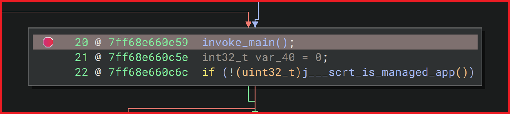

  
  <!--  -->
  

### 🕶️ Common vulnerabilities and Exposures
> Empty

### ✍️ Community
> [🔗](https://developercommunity.visualstudio.com/t/I-would-like-to-ask-you-to-redefine-so-t/11098247) [Microsoft][RPC] Suggest redefining the RPC String type.

### 🏫 Education
> (前) 2012.03 ~ 2015.02 
> &ensp;&ensp;&ensp;- Busan National Mechanical Technical High School 
> &ensp;&ensp;&ensp;- Department of Robotics Technology

### 🕹️ Work Experience
> (現) 2025/09 ~ 
> &ensp;&ensp;&ensp;- Unemployed 
> (前) 2024/06 ~ 2025/08 
> &ensp;&ensp;&ensp;- T3 Entertainment Inc. 
> &ensp;&ensp;&ensp;- Game Server Program Team 
> &ensp;&ensp;&ensp;- RPG 
> &ensp;&ensp;&ensp;- Inventory, Equipment, Quick Slot, Item, Crafting, Achievement, Guild and Cheat System Engineering 
> (前) 2021/11 ~ 2023/01 
> &ensp;&ensp;&ensp;- Wonder People Co., Ltd. 
> &ensp;&ensp;&ensp;- Game Client Program Team 
> &ensp;&ensp;&ensp;- AAA Battle Royal FPS 
> &ensp;&ensp;&ensp;- Abusing, Tutorial and Play Guide System Engineering 
> (前) 2017/03 ~ 2018/07 
> &ensp;&ensp;&ensp;- POSCO Co., Ltd. 
> &ensp;&ensp;&ensp;- Electricity, Instrumentation and Computer Technology Department 
> &ensp;&ensp;&ensp;- Hardware, Network Engineering 
> (前) 2015/03 ~ 2016/12 
> &ensp;&ensp;&ensp;- ROKA, Capital Defense Command

### 🧮 Stacks
>
>
>
>
>
>
>
>

### 📜 Certifications
> 
> 
> 
>